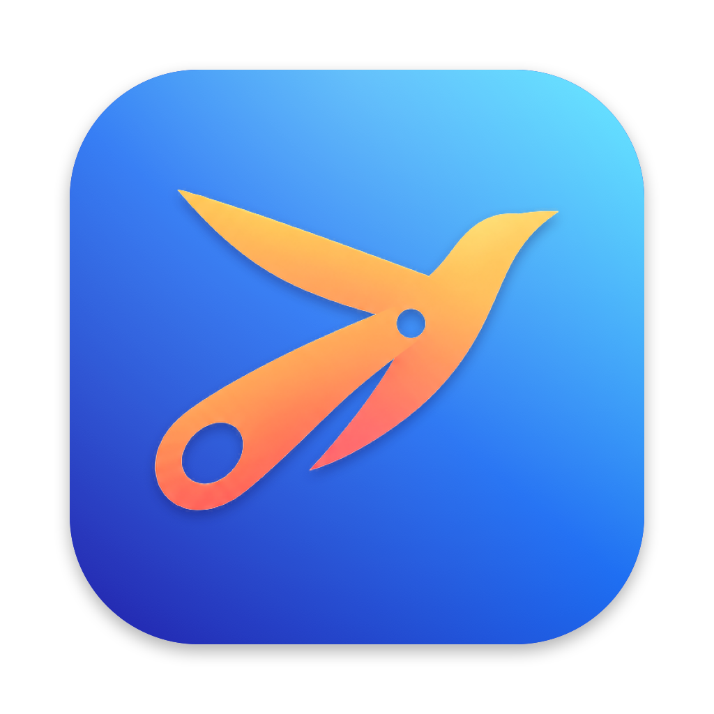

# Soarcut

Soarcut is a clean, simple clipboard manager for macOS developers. Every time you copy something, Soarcut keeps it in history. Press **Shift-Command-V** to bring up the bezel, keep holding the modifiers, tap **V** (or the arrow keys) to pick an older clipping, and release to paste it.

Soarcut continues a long lineage: [Jumpcut](http://jumpcut.sourceforge.net) by Steve Cook (2002) → [Flycut](https://github.com/TermiT/Flycut) by General Arcade (2011) → Soarcut (2026). Jump, fly, soar.

## What's different from Flycut

- **Bezel no longer gets stuck** when a system prompt or another window takes focus ([TermiT/Flycut#201](https://github.com/TermiT/Flycut/issues/201)).
- **Pop Paste hotkey** (optional): paste, then step to the next older clipping on each press.
- **Type as keystrokes**: press **T** in the bezel, or hold Option in the menu, for fields that block paste (VM consoles, remote desktops).
- **Lower idle CPU** and fewer redraws.
- A clear alert when paste fails because Accessibility access is missing.
- Launch at login uses the modern macOS API.
- macOS only, distributed outside the App Store: no iOS app, no iCloud sync, no sandbox.

## Install

Download the latest release from [Releases](https://github.com/jackfreem/Soarcut/releases), move **Soarcut.app** to Applications, and allow it in **System Settings → Privacy & Security → Accessibility** so it can paste for you.

## Privacy and security

- Soarcut **skips clipboard items that password managers mark as concealed or transient** (1Password, Bitwarden and other apps that follow the [nspasteboard.org](http://nspasteboard.org) convention). This is on by default under Preferences > General.
- Clipboard history is kept in memory and, by default, **saved unencrypted on quit** to `~/Library/Preferences/com.jackfreem.soarcut.plist`, readable by other apps running as you. To keep history in memory only, set **Preferences > General > Save** to **Never**.
- Soarcut sends nothing over the network. Accessibility access is used only to press Cmd-V (or type a clipping) for you.
- Releases list a SHA-256 checksum for the DMG. Until releases are Developer ID signed and notarized, macOS will warn on first launch; check the checksum before approving it.

Please report security issues privately through GitHub's **Report a vulnerability** button on the Security tab rather than in a public issue.

## Use

See the [help file](help.md) for all bezel keys and menu features.

## Build

Open `Flycut.xcodeproj` in Xcode 26.3 or later and build the **Flycut** scheme. The product is `Soarcut.app`. (Internal names still say Flycut, which keeps merging upstream fixes easy.)

## Credits and license

MIT. Soarcut builds on the work of Flycut's contributors and on Jumpcut. See [acknowledgements.txt](acknowledgements.txt) for the libraries used and their authors.
